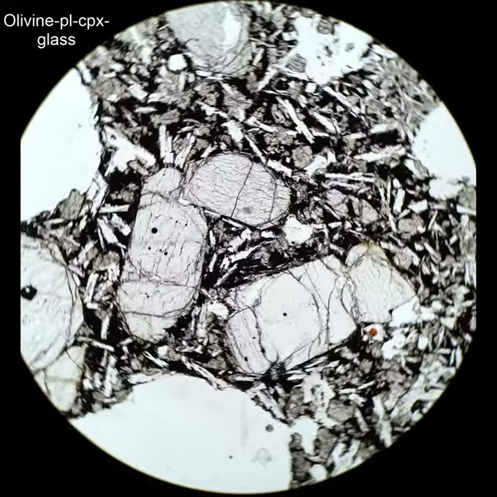

**Live site:** [buchanankerswell.com/light_slides](https://buchanankerswell.com/light_slides)

## Summary

[Light Slides](https://buchanankerswell.com/light_slides) is a free study viewer for learning minerals under the microscope. It follows the textbook *Optical Mineralogy* by Perkins, Kohn & Brady ([optical.minpet.org](https://optical.minpet.org)). Rotate the microscope stage back and forth while Prof. Kohn explains what you are looking at. It runs in any web browser.

---

---

## Features

- Rotate the stage while each view is explained
- Search tutorials by mineral, feature, or color
- Free in any web browser

---

## Collaborators

- [Prof. Matthew Kohn](https://scholar.google.com/citations?user=xSyB1KQAAAAJ&hl=en&oi=ao) (Boise State University)

## Acknowledgement

These videos and tutorials were produced by Prof. Matthew Kohn (Boise State University) from hours of filming petrographic slides from his own personal research library. Light Slides accompanies *Optical Mineralogy* by [Dexter Perkins](https://campus.und.edu/directory/dexter.perkins) (University of North Dakota), Matthew Kohn (Boise State University), and [John Brady](https://scholar.google.com/citations?user=fZ1icDoAAAAJ&hl=en&oi=sra) (Smith College). Supported by the University of North Dakota, Boise State University, Smith College, and the National Science Foundation.

## Open Research

All viewer code is MIT Licensed and free for use and distribution at [https://github.com/buchanankerswell/light_slides](https://github.com/buchanankerswell/light_slides).
