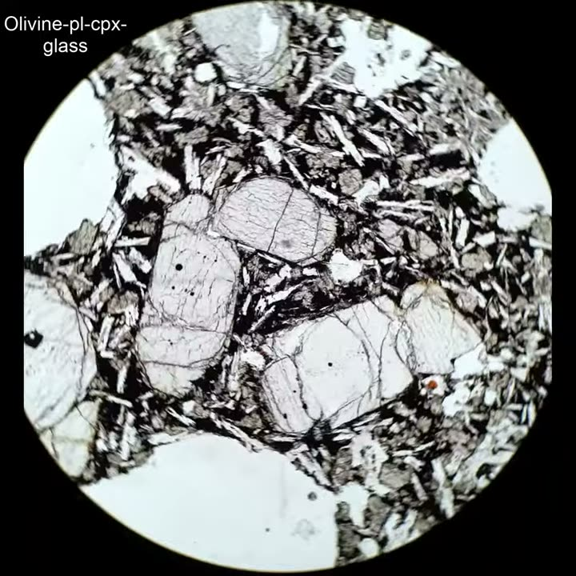

**Live site:** [buchanankerswell.com/light_slides](https://buchanankerswell.com/light_slides)

## Summary

[Light Slides](https://buchanankerswell.com/light_slides) is a free study viewer for learning minerals under the microscope. It follows the textbook *Optical Mineralogy* by Perkins, Kohn & Brady ([optical.minpet.org](https://optical.minpet.org)). Drag a slider to move the microscope stage back and forth while short notes explain what you are looking at. It runs in any web browser, and the videos stream from the cloud so the site stays small.

---

*Figure:* Poster image for the olivine tutorial. Each tutorial pairs microscope footage with short explanatory notes.

---

## Features

- Drag a slider to move the stage while short notes explain each view
- Find tutorials by mineral, feature, or color
- Free in any browser; videos stream from the cloud

---

## Collaborators

- [Matthew Kohn](https://scholar.google.com/citations?user=xSyB1KQAAAAJ&hl=en&oi=ao) (Boise State University)

## Acknowledgement

These videos and tutorials were produced by Matt Kohn (Boise State University) from hours of filming petrographic slides from his own personal research library. Light Slides accompanies *Optical Mineralogy* by [Dexter Perkins](https://campus.und.edu/directory/dexter.perkins) (University of North Dakota), Matt Kohn (Boise State University), and [John Brady](https://scholar.google.com/citations?user=fZ1icDoAAAAJ&hl=en&oi=sra) (Smith College). Supported by the University of North Dakota, Boise State University, Smith College, and the National Science Foundation.

## Open Research

All viewer code is MIT Licensed and free for use and distribution at [https://github.com/buchanankerswell/light_slides](https://github.com/buchanankerswell/light_slides).
